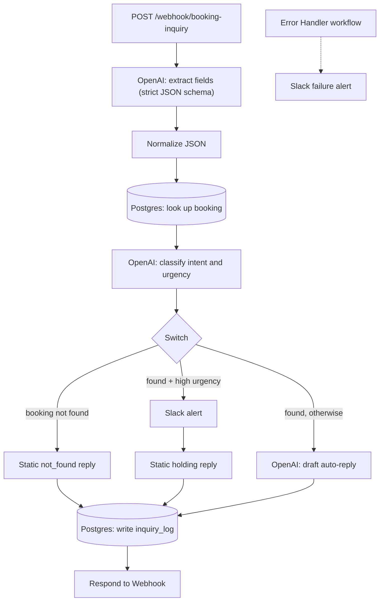

# Booking Inquiry Triage (n8n + OpenAI + Postgres)

A self-hosted n8n workflow that takes a customer's booking message through a webhook, extracts the booking details, looks the booking up in Postgres, classifies intent and urgency, and routes it to the right response. Every request is written to an `inquiry_log` table.

## What it does

1. **Webhook** receives `POST /webhook/booking-inquiry` with `{"message": "..."}`.
2. **OpenAI (gpt-5.4-nano)** extracts `booking_ref`, `route`, `original_date`, `new_date` and `requested_change` using a strict JSON schema. Relative dates ("next Friday") are returned as `null`, never guessed.
3. **Postgres** looks up the booking by reference.
4. A second **OpenAI** node classifies intent (`date_change`, `cancellation`, `inquiry`, `complaint`, `other`) and urgency (`low`, `medium`, `high`).
5. A **Switch** routes the request:
   - `not_found`: the booking reference isn't in the database. Static reply asking the customer to verify it.
   - `escalate`: booking found and urgency is high. Posts a Slack alert, then returns a static holding reply.
   - `auto_reply` (default): a third OpenAI node drafts a short reply based only on the booking record.
6. Every request is inserted into `inquiry_log`, and the webhook responds with the branch, booking reference and reply.
7. A separate **Error Handler** workflow posts to Slack when the main workflow fails.

## Architecture



Canvas screenshot: `docs/canvas.png`

## Design decisions

- **Strict JSON schema on every structured LLM call**, so downstream nodes never parse free text.
- **No date inference.** If a date isn't explicit in the message, the extractor returns `null`.
- **Booking existence is decided by the database, not the model.** The LLM only extracts the reference; Postgres says whether it exists.
- **Parameterized SQL** for both the lookup and the log insert.
- **Single log writer.** All three branches converge on one insert, so every request is logged the same way.
- **Slack alert is best-effort.** The Slack node is set to *On Error: Continue*, so a Slack failure does not stop the log write or the customer response.
- **Separate error workflow** for failures in the main workflow.

## Repository layout

## Setup

Requirements: Docker with Compose v2, an OpenAI API key, and a Slack app/bot token with access to a channel.

```bash
git clone https://github.com/YOUR_GITHUB_USERNAME/booking-inquiry-triage.git
cd booking-inquiry-triage
cp .env.example .env        # then set POSTGRES_PASSWORD
docker compose up -d

docker compose exec -T postgres psql -U n8n -d n8n -v ON_ERROR_STOP=1 < db/schema.sql
docker compose exec -T postgres psql -U n8n -d n8n -v ON_ERROR_STOP=1 < db/seed.sql
```

Then open http://localhost:5679 and:

1. Create the n8n owner account.
2. Create three credentials: **OpenAI**, **Slack**, and **Postgres** (host `postgres`, port `5432`, database and user from your `.env`, SSL disabled).
3. **Import** `workflows/booking-inquiry-intake.json` and `workflows/error-handler.json` (workflow menu -> Import from file).
4. Select your credentials on the OpenAI, Postgres and Slack nodes, and set the Slack channel on both Slack nodes (the exported files contain the placeholder `YOUR_SLACK_CHANNEL_ID`).
5. In *booking-inquiry-intake* -> Settings, set **Error Workflow** to *Error Handler*.
6. Activate the workflow.

Test it:

```bash
curl -s -X POST http://localhost:5679/webhook/booking-inquiry \
  -H 'Content-Type: application/json' \
  -d '{"message": "Please change booking ZZZ999 to 2026-12-01."}'
```

Or open `test-form.html` in a browser. Check the log with:

```bash
docker compose exec postgres psql -U n8n -d n8n -c "select id, booking_ref, intent, urgency, branch from inquiry_log order by id;"
```

## Tests

`tests/tests.json` holds the edge cases below.

| # | Case | Result |
|---|---|---|
| 1 | Valid ref, simple inquiry | `auto_reply`, reply matches record |
| 2 | Valid ref, date change | `auto_reply`, new date extracted, no availability promised |
| 3 | Valid ref, urgent cancellation | Slack alert with booking ref |
| 4 | Garbled ref (`BK45Z1`) | `not_found`, no false match |
| 5 | No ref in message | `not_found`, `booking_ref` is `null`, nothing hallucinated |
| 6 | Relative date ("next Friday") | `auto_reply`, date not inferred, reply asks for a specific date |
| 7 | Ambiguous intent | `auto_reply`, asks for the preferred new time |
| 8 | Very short message | `not_found`, no fields invented |
| 9 | Mixed language (Roman Urdu + English) | Extracted and handled correctly |
| 10 | Same ref twice, back to back | Both processed [CONFIRM: two rows in `inquiry_log`] |

## Known limitations

- **The webhook is unauthenticated** in this demo. Add Header Auth on the Webhook node before exposing it beyond localhost.
- The Error Handler only fires for **production (active) executions**, not manual runs in the editor.
- Escalation requires the booking to exist: an urgent message with an unknown booking reference goes to `not_found`.
- The holding reply on the escalate branch is static text.
- `N8N_ENCRYPTION_KEY` is not set, so n8n generates one inside the `n8n_data` volume. Deleting that volume makes saved credentials unreadable.
- Compose runs n8n over plain HTTP with `N8N_SECURE_COOKIE=false`, which is fine for local use only.

## Demo

Walkthrough video: LOOM_URL

## License

MIT
